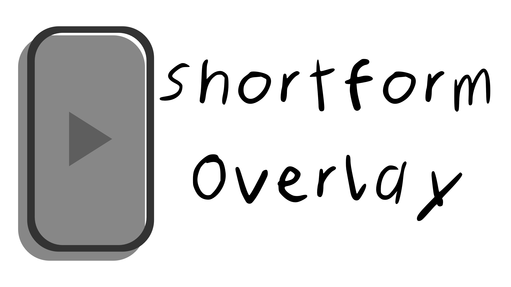

<p align="center">
  
</p>

# Shortform Overlay for DaVinci Resolve

An open-source DaVinci Resolve template providing instant, drop-down safe-zone overlays for TikTok, YouTube Shorts, Instagram Reels, Snapchat Spotlight, and a combined multiplatform view, complete with an opacity slider directly below the selection menu, to ensure your vertical video content is never cut off by platform UI.

---

## Features

* **All-in-One Generator:** A single Fusion template (`.setting`) containing overlays for all major short-form platforms.
* **Easy Dropdown Selection:** Switch dynamically between TikTok, YouTube Shorts, Instagram Reels, Multiplatform, and Snapchat Spotlight using a simple drop-down menu in the Inspector panel. Multiplatform is selected by default.
* **Opacity Slider:** Adjust the overlay from 0% to 100% with an editable value. At 100% the overlay is fully visible, at 50% it is semi-transparent over your footage, and at 0% it disappears completely.
* **Built-in ResolveFX Transform:** Fine-tune or tweak the placement directly inside the tool controls.
* **Native .drfx Package:** Easy, cross-platform installation that works seamlessly on Windows, macOS, and Linux.

---

## Installation

### Method 1: Automatic .drfx Installation (Recommended)
1. Download the `ShortformOverlay.drfx` from the [Releases](../../releases) page.
2. Double-click the downloaded `.drfx` file.
3. DaVinci Resolve will open and ask if you want to install the template. Click **Install**.

### Method 2: Manual Installation
If you prefer to install it manually without the `.drfx` bundle:
1. Go to the `plugin-source` folder in this repository.
2. Copy `ShortformOverlay.setting`, `ShortformOverlay.png`, and the five asset images (`TikTokOverlay.png`, `YouTubeShortsOverlay.png`, `InstagramReelsOverlay.png`, `MultiplatformOverlay.png`, `SnapchatSpotlightOverlay.png`).
3. Navigate to your DaVinci Resolve Fusion directory:
   * **Windows:** `%APPDATA%\Blackmagic Design\DaVinci Resolve\Support\Fusion\Templates\Edit\Generators\`
   * **macOS:** `~/Library/Application Support/Blackmagic Design/DaVinci Resolve/Fusion/Templates/Edit/Generators/`
4. Paste all seven files into the `Generators` folder (create a subfolder named `ShortformOverlay` to keep it clean).

---

## How to Use

1. After installation, open DaVinci Resolve and head to the **Edit Page**.
2. Open the **Effects Library** and look under **Generator > ShortformOverlay**.
3. Drag and drop **ShortformOverlay** onto your timeline above your video track.
4. Open the **Inspector** panel in the top right.
5. Use the **Platform** dropdown menu to toggle between TikTok, YouTube Shorts, Instagram Reels, Multiplatform, and Snapchat Spotlight layout guides.
6. Use the **Opacity (%)** slider directly below the dropdown to fade the overlay in or out.

---

## How to Build the .drfx Yourself (Developers)

If you want to modify the source files and build your own `.drfx` plugin package, follow these steps:

1. Open the `plugin-source` folder. Inside, you will find the `Edit` folder.
2. Ensure the internal structure looks exactly like this:
   ```text
   Edit/
   └── Generators/
       └── ShortformOverlay/
           ├── ShortformOverlay.setting
           ├── ShortformOverlay.png
           ├── TikTokOverlay.png
           ├── YouTubeShortsOverlay.png
           ├── InstagramReelsOverlay.png
           ├── MultiplatformOverlay.png
           └── SnapchatSpotlightOverlay.png
   ```